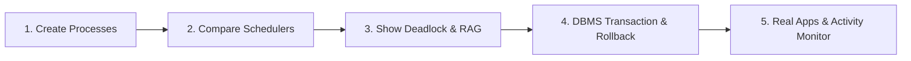

# SysRealm — Operating System & Database Management System Simulation Platform

SysRealm is an educational full-stack simulator for Computer Science students and instructors. It provides interactive, visual demonstrations of core Operating System mechanisms (CPU scheduling, memory paging/translation, disk scheduling, Banker's algorithm, resource allocation graphs, and deadlock detection) coupled with an enterprise-grade Relational Database Management System (ACID transactions, triggers, relational joins, query optimization, and cost-based query rewriting).

---

## 1. Storage Architecture (Dual-Mode)

SysRealm is designed to run seamlessly in two database modes without code changes:

1. **MySQL 8.0+ Mode (Primary Enterprise Storage)**:
   - Configured via environment variables (`DB_HOST`, `DB_PORT`, `DB_USER`, `DB_PASSWORD`, `DB_NAME`).
   - Uses `InnoDB` storage engine with foreign keys (`ON DELETE CASCADE`), indexes, composite unique constraints (`UNIQUE(session_id, pid)`), and 4 automated database triggers (`trg_before_process_insert`, `trg_after_process_insert`, `trg_after_process_terminate`, `trg_after_resource_allocation`).
2. **SQLite Mirror Mode (Zero-Config Fallback)**:
   - If MySQL is offline or not installed, SysRealm automatically falls back to an embedded SQLite database (`sysrealm_mysql_mirror.db`).
   - Replicates the exact schema, table structures, foreign keys, and trigger logic so that all transactional rollbacks, joins, and activity logs execute identically.

---

## 2. Security & Hardening

- **Salted Password Hashing**: Passwords are encrypted using salted `scrypt` (via `werkzeug.security`). Legacy SHA-256 hashes are verified for backward compatibility and automatically upgraded to salted `scrypt` upon successful login.
- **Role Provisioning**: Public registration (`/register`) is permanently locked to the `student` role. Teacher accounts cannot self-register and must be provisioned via the administrative CLI tool (`provision_teacher.py`).
- **Session State Isolation**: Simulation state is completely isolated per user session using per-user engine dispatch (`_user_engines[email]` via `LocalProxy`). Two simultaneous logged-in users can run simulations concurrently without cross-talk or shared state.
- **Route Authorization**: All data mutation and simulation API endpoints require active authentication (`@login_required`), returning HTTP 401 JSON errors on unauthorized API calls and redirecting browser sessions to `/login`. Instructor controls are restricted with `@teacher_required`.
- **Zero Hardcoded Secrets**: Secrets are loaded from environment variables or dynamically generated using `secrets.token_hex(32)` if `.env` is absent. `.env` is omitted from ZIP bundles and git tracking.

---

## 3. Quickstart & Installation

### Prerequisites
- Python 3.9+
- (Optional) MySQL 8.0+

### Setup Steps
```bash
# 1. Clone repository and navigate to directory
cd SysRealm

# 2. (Optional) Create and activate virtual environment
python3 -m venv venv
source venv/bin/activate  # On Windows: venv\Scripts\activate

# 3. Install dependencies
pip install -r requirements.txt

# 4. (Optional) Configure MySQL credentials
cp .env.example .env
# Edit .env with your MySQL settings if using MySQL server

# 5. Provision a Teacher Account
python3 provision_teacher.py
# Default: teacher@sysrealm.com / Teacher@123 (or specify custom credentials)

# 6. Run Automated Test Suite
python3 -m unittest discover tests

# 7. Start SysRealm Server
python3 app.py
```
Open **http://localhost:8080** in your browser.

---

## 4. Virtual Apps Lab

The **Virtual Apps Lab** turns visible app activity into the same process records used by the CPU Scheduler. It includes four interactive workloads:

- **Lab Browser** — navigate or search the local systems guide.
- **Tone Player** — select and play virtual audio tracks.
- **Signal Sprint** — start a reaction round and register correct inputs.
- **Download Desk** — queue a simulated sample-file transfer.

Each action generates a small group of processes with realistic arrival times, burst lengths, priorities, and memory requirements. Select **Start clean app lab** to remove the demonstration workload, interact with the apps, and then select **Open CPU Scheduler** to run FCFS, SJF, Priority, or Round Robin on that exact shared process queue.

You can also create reusable custom apps directly in the browser: choose a name, icon, action label, and one or more process steps. Custom app definitions are saved in browser storage; their generated processes still go through the normal authenticated `/api/processes` endpoint and the existing scheduler pipeline.

---

## 5. API Endpoints Reference

### Authentication & Teacher Controls
| Endpoint | Method | Role | Description |
|---|---|---|---|
| `/login` | GET / POST | Public | User authentication; auto-upgrades legacy password hashes |
| `/register` | GET / POST | Public | Student self-registration (locked to student role) |
| `/logout` | GET / POST | Logged In | Clears session context |
| `/api/teacher/students` | GET | Teacher | List registered students and live audit activity |
| `/api/activity/log` | POST | Student | Record student interaction event |

### Session & Process Management
| Endpoint | Method | Description |
|---|---|---|
| `/api/sessions` | POST / GET | Create or list simulation sessions |
| `/api/sessions/<id>` | GET | Retrieve session details and associated logs |
| `/api/processes` | POST / GET | Create or list processes for active session |
| `/api/processes/<pid>` | DELETE | Terminate and remove process |

### CPU Scheduling
| Endpoint | Method | Description |
|---|---|---|
| `/api/scheduler/run` | POST | Run FCFS, Priority, Round Robin, or SJF; commits run in one atomic DB transaction |
| `/api/scheduler/step` | POST | Step-by-step event playback (arrivals, context switches, terminations) |
| `/api/scheduler/reset` | POST | Clear scheduling queues and reset clock |
| `/api/scheduler/state` | GET | Retrieve ready queue, CPU state, and metrics |
| `/api/scheduler/compare` | POST | Benchmark all 4 algorithms on caller-supplied custom processes |

### Memory Management & Paging
| Endpoint | Method | Description |
|---|---|---|
| `/api/memory` | GET | Physical memory state and frame allocation table |
| `/api/memory/allocate` | POST | Allocate physical memory blocks (educational 512 MB scale) |
| `/api/memory/release` | POST | Free process frames |
| `/api/memory/paging-demo` | POST | Populate two-level page table and MMU mapping |
| `/api/memory/scatter` | POST | Demonstrate non-contiguous frame allocation |
| `/api/memory/translate` | POST | MMU virtual-to-physical address translation |
| `/api/memory/page-replacement` | POST | FIFO, LRU, and Optimal page replacement simulation |

### Disk Scheduling
| Endpoint | Method | Description |
|---|---|---|
| `/api/disk/simulate` | POST | Simulate FCFS, SSTF, SCAN, C-SCAN, LOOK, C-LOOK; supports duplicate requests |
| `/api/disk/compare` | POST | Compare seek counts, step traces, and cylinder graphs across all algorithms |

### Integrated OS Pipeline
| Endpoint | Method | Description |
|---|---|---|
| `/api/integrated/demo` | GET | Load processes that perform CPU bursts, page requests, and disk I/O |
| `/api/integrated/run` | POST | Execute end-to-end coordinated simulation (CPU -> MMU -> Disk) |
| `/api/integrated/step` | POST | Single-step execution across CPU, MMU, and disk subsystems |
| `/api/integrated/state` | GET | Consolidated status of processes, memory frames, and disk queue |
| `/api/integrated/reset` | POST | Reset integrated pipeline |

### Deadlock Detection & Banker's Algorithm
| Endpoint | Method | Description |
|---|---|---|
| `/api/resources` | GET | Available and allocated system devices (Printer, Disk, Network, I/O) |
| `/api/resources/request` | POST | Request hardware resource |
| `/api/resources/release` | POST | Release hardware resource |
| `/api/deadlock/detect` | POST | Resource Allocation Graph (RAG) cycle analysis + Banker's safety reduction |
| `/api/deadlock/scenario` | POST | Load classic 2-process or 3-process circular wait scenarios |
| `/api/deadlock/custom` | POST | Detect deadlock on custom user-provided resource graphs |
| `/api/deadlock/prevent` | POST | Apply deadlock prevention (Havender's resource ordering / hold-and-wait hold) |
| `/api/banker/check` | POST | Banker's safety algorithm check on allocation / max / available matrices |
| `/api/banker/request` | POST | Validate resource-request safety before granting |

### Storage & Filesystem
| Endpoint | Method | Description |
|---|---|---|
| `/api/files` | GET / POST | List or create files on simulated secondary storage |
| `/api/files/<file_id>` | DELETE | Delete simulated file |

### Multi-Process Desktop Applications & Memory Management (Activity Monitor / Taskbar)
| Endpoint | Method | Description |
|---|---|---|
| `/api/apps/list` | GET | Retrieve application blueprints, active process hierarchies, and swap space |
| `/api/apps/launch` | POST | Launch multi-process app (Browser, SysCode, PulseStream, NeoRender); allocates RAM frames |
| `/api/apps/spawn-tab` | POST | Dynamically spawn child worker or browser tab in running application |
| `/api/apps/kill-process` | POST | Interactive End Task: terminate individual child process/tab and reclaim its frames |
| `/api/apps/terminate` | POST | Close entire application tree and release all RAM & swap frames |
| `/api/apps/swap` | POST | Virtual Memory Paging: swap out process to simulated disk or swap back in to RAM |
| `/api/apps/oom-killer` | POST | Run Kernel Out-Of-Memory (OOM) Killer daemon using Badness Score heuristic |
| `/api/apps/stress-test` | POST | Simulate heavy RAM pressure (>85%) to demonstrate OOM Killer invocation |
| `/api/apps/reset` | POST | Close all active applications, restore RAM, and clear swap partition |

### DBMS Engine & Query Optimization Lab
| Endpoint | Method | Role | Description |
|---|---|---|---|
| `/api/dbms/status` | GET | Teacher | Server connection state, active triggers, and table row counts |
| `/api/dbms/connect` | POST | Teacher | Dynamic MySQL connection re-binding |
| `/api/dbms/fire-trigger` | POST | Teacher | Demonstrate BEFORE INSERT, AFTER INSERT, AFTER UPDATE, and AUDIT triggers |
| `/api/dbms/join` | POST | Teacher | Run INNER JOIN, LEFT OUTER JOIN, 3-Table JOIN, and GROUP BY aggregations |
| `/api/dbms/transaction` | POST | Teacher | Demonstrate ACID atomicity, rollback on mid-transaction error, and savepoints |
| `/api/dbms/schema` | GET | Teacher | 3NF/BCNF data catalog, candidate keys, and foreign keys |
| `/api/dbms/optimize-query` | POST | Logged In | Relational algebra heuristic optimization tree |
| `/api/dbms/rewrite-query` | POST | Logged In | Cost-based query transformation and indexing suggestions |
| `/api/assignments` | GET | Logged In | View published teacher assignments and student submission status |
| `/api/teacher/assignments` | POST / DELETE | Teacher | Publish or revoke query optimization assignments |
| `/api/assignments/<id>/submit-optimizer` | POST | Student | Submit rewritten query for verification |
| `/api/teacher/submissions/<id>/verify` | POST | Teacher | Grade and verify student query submissions |

---

## 6. Automated Test Suite

SysRealm includes an automated test suite verifying core systems under `tests/test_sysrealm.py`:

```bash
python3 -m unittest discover tests
```

### Verified Test Cases:
1. **CPU Scheduler Staggered Arrivals** (`TestCPUSchedulerStaggered`):
   - Validates processes arriving at different times ($t=0, 1, 2$) under FCFS.
   - Verifies Gantt timeline segments, individual process completion, turnaround, waiting, and response times ($WT=[0, 3, 5]$, $TAT=[4, 6, 6]$, $RT=[0, 3, 5]$).
2. **Classic Deadlock RAG Detection** (`TestDeadlockClassicRAG`):
   - Verifies classic circular wait: $P_1$ holds $R_1$, wants $R_2$; $P_2$ holds $R_2$, wants $R_1$.
   - Confirms cycle identification and Banker's safety reduction deadlock confirmation.
3. **Memory Capacity & Boundary Enforcement** (`TestMemoryManagerCapacity`):
   - Tests allocation at full capacity (1024 MB total across 2 blocks) and ensures requests exceeding available frames fail cleanly with insufficient frame errors.
4. **Database Transaction Rollback with Triggers** (`TestDatabaseTransactionRollback`):
   - Verifies transactional atomicity: when an insertion transaction is aborted, the inserted process, trigger-generated audit logs, and session counters are all cleanly rolled back with zero partial changes.
5. **Canonical Disk Scheduling Benchmark** (`TestDiskSchedulingCanonical`):
   - Tests canonical benchmark: requests `[98, 183, 37, 122, 14, 124, 65, 67]`, initial head `53` $\rightarrow$ FCFS total seek distance equals exactly **640** cylinders.
   - Tests repeated cylinder requests (`[65, 65, 98]`) verifying correct average seek calculation.
6. **Multi-Process Desktop Applications & Memory Management** (`TestRealAppsAndMemoryManagement`):
   - Validates hierarchical process launching across multi-process applications (Browser, SysCode Studio).
   - Validates dynamic tab worker spawning and physical RAM boundary limits.
   - Tests interactive child process termination (End Task) and RAM reclamation.
   - Tests virtual memory page-out to simulated disk swap partition and page-in restoration.
   - Tests Kernel OOM Killer badness score heuristic: ensures background worker tabs are targeted while core UI processes are protected.

---

## 7. Evaluation Presentation Demo Flow

For evaluators and viva presentations, follow this concise 5-step sequence:



1. **Step 1: Create Custom Processes**
   - Log in as student (`student@sysrealm.com` or create a new student account).
   - Go to **CPU Scheduler** $\rightarrow$ add 3 custom processes with staggered arrival times and burst times.
2. **Step 2: Compare Scheduling Algorithms**
   - Click **Compare Algorithms**. Notice how SysRealm simulates all 4 algorithms (FCFS, SJF, Priority, Round Robin) on your exact custom processes and generates side-by-side Gantt charts and waiting time benchmarks.
3. **Step 3: Deadlock Detection & Prevention**
   - Navigate to **Deadlock Detection** $\rightarrow$ load the **2-Process Circular Wait** scenario.
   - Click **Detect Deadlock**. SysRealm renders the Resource Allocation Graph (RAG), highlights the cycle ($P_1 \to R_2 \to P_2 \to R_1 \to P_1$), and explains single vs multi-instance resource graph theorems.
   - Click **Apply Prevention (Resource Ordering)** to eliminate circular wait.
4. **Step 4: ACID Transaction Atomicity & Rollback**
   - Log in as teacher (`teacher@sysrealm.com`).
   - Open the **DBMS Laboratory** $\rightarrow$ select **Transaction Rollback Demo**.
   - Execute the test. Show that mid-transaction failure cleanly rolls back the process insertion and undoes the trigger-generated activity log, proving strict database consistency and atomicity.
5. **Step 5: Multi-Process Desktop Apps, Activity Monitor & Kernel OOM Killer**
   - Look at the bottom **Floating OS Dock / Taskbar**.
   - Click to launch **Quantum Web Browser** or **NeoRender 3D Simulation**. Watch the individual child processes and tabs appear in the CPU Scheduler ready queue and claim physical memory frames.
   - Click **Activity Monitor** to open the draggable macOS/Windows-style Task Manager window.
   - Expand the process tree, click **End Task** on a child tab to reclaim RAM, or click **Swap to Disk** to demonstrate virtual memory demand paging.
   - Click **Stress RAM** and trigger the **Kernel OOM Killer** daemon to observe the live Badness Score calculation and automatic rogue process eviction.
