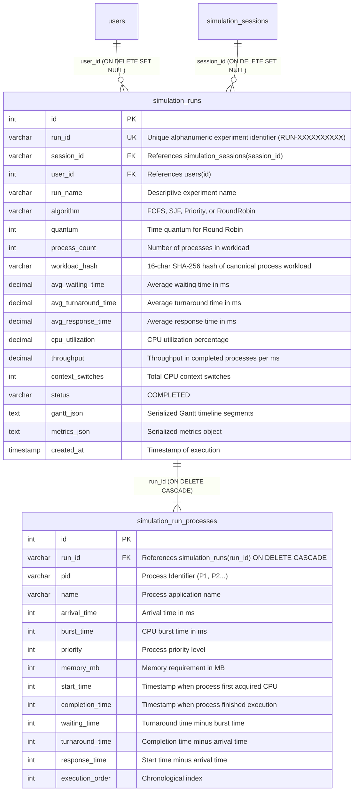

# SysRealm: Simulation History & Performance Analytics

## 1. Module Overview & Academic Purpose

The **Simulation History & Performance Analytics** module extends the SysRealm operating systems and database educational environment by transforming ephemeral in-memory simulations into **durable, queryable experimental records**.

In traditional computer science coursework, students often run CPU scheduling simulations (FCFS, SJF, Priority, Round Robin) with arbitrary values and lose their experimental data as soon as the simulator resets. This module bridges operating systems principles with relational database management systems (RDBMS) by enabling students to:
1. **Persist Simulation Experiments**: Automatically store execution configurations, process workloads, process control block (PCB) metrics, and Gantt timeline segments in a relational database.
2. **Revisit Historical Experiments**: Inspect past simulation runs with full process-level granularity without re-executing.
3. **Conduct Fair Algorithm Benchmarks**: Compare 2 to 5 scheduling algorithms side-by-side with automated **workload equivalence verification** via cryptographic workload hashing.
4. **Analyze Long-Term Trends**: Execute real SQL aggregate queries (`GROUP BY`, `AVG`, `MIN`, `MAX`, `COUNT`) to inspect algorithm performance distributions and best observed benchmarks.
5. **Reproduce Workloads (Rerun)**: Load any historical workload directly into the active CPU Scheduler with a single click to test alternative scheduling algorithms on an identical process set.

SysRealm maintains **dual database fidelity**: all tables, indexes, constraints, and transactions are supported identically across **MySQL 8.0 (InnoDB)** and the **SQLite 3 WAL fallback mirror** (`sysrealm_mysql_mirror.db`).

---

## 2. Database Architecture & Relational Schema

The module introduces two normalized relational tables with primary keys, foreign keys, cascade rules, and optimized B-tree indexes:



### 2.1 MySQL DDL Definition

```sql
CREATE TABLE IF NOT EXISTS simulation_runs (
    id INT AUTO_INCREMENT PRIMARY KEY,
    run_id VARCHAR(64) NOT NULL UNIQUE,
    session_id VARCHAR(255) NULL,
    user_id INT NULL,
    run_name VARCHAR(150) NOT NULL,
    algorithm VARCHAR(50) NOT NULL,
    quantum INT NULL,
    process_count INT NOT NULL DEFAULT 0,
    workload_hash VARCHAR(64) NOT NULL,
    avg_waiting_time DECIMAL(10, 2) NOT NULL DEFAULT 0.00,
    avg_turnaround_time DECIMAL(10, 2) NOT NULL DEFAULT 0.00,
    avg_response_time DECIMAL(10, 2) NOT NULL DEFAULT 0.00,
    cpu_utilization DECIMAL(5, 2) NOT NULL DEFAULT 0.00,
    throughput DECIMAL(8, 4) NOT NULL DEFAULT 0.0000,
    context_switches INT NOT NULL DEFAULT 0,
    status VARCHAR(50) NOT NULL DEFAULT 'COMPLETED',
    gantt_json LONGTEXT NULL,
    metrics_json TEXT NULL,
    created_at TIMESTAMP DEFAULT CURRENT_TIMESTAMP,
    FOREIGN KEY (session_id) REFERENCES simulation_sessions(session_id) ON DELETE SET NULL,
    FOREIGN KEY (user_id) REFERENCES users(id) ON DELETE SET NULL,
    INDEX idx_simrun_workload (workload_hash),
    INDEX idx_simrun_algo (algorithm),
    INDEX idx_simrun_created (created_at),
    INDEX idx_simrun_session (session_id)
) ENGINE=InnoDB CHARACTER SET utf8mb4 COLLATE utf8mb4_unicode_ci;

CREATE TABLE IF NOT EXISTS simulation_run_processes (
    id INT AUTO_INCREMENT PRIMARY KEY,
    run_id VARCHAR(64) NOT NULL,
    pid VARCHAR(50) NOT NULL,
    name VARCHAR(255) NOT NULL,
    arrival_time INT NOT NULL,
    burst_time INT NOT NULL,
    priority INT NOT NULL DEFAULT 1,
    memory_mb INT NOT NULL DEFAULT 512,
    start_time INT NULL,
    completion_time INT NULL,
    waiting_time INT NOT NULL DEFAULT 0,
    turnaround_time INT NOT NULL DEFAULT 0,
    response_time INT NULL,
    execution_order INT NOT NULL DEFAULT 0,
    FOREIGN KEY (run_id) REFERENCES simulation_runs(run_id) ON DELETE CASCADE,
    UNIQUE KEY uk_simrun_proc (run_id, pid),
    INDEX idx_simrunproc_run (run_id),
    INDEX idx_simrunproc_pid (pid)
) ENGINE=InnoDB CHARACTER SET utf8mb4 COLLATE utf8mb4_unicode_ci;
```

---

## 3. Workload Equivalence & Workload Hashing

In operating systems performance evaluation, **comparing two scheduling algorithms on different process workloads is scientifically invalid**. For example, comparing FCFS on short processes with Round Robin on long CPU-bound processes would lead to completely misleading conclusions.

### 3.1 Deterministic Workload Hashing Algorithm

To solve this, SysRealm generates a deterministic 16-character cryptographic hash of the input workload:

$$\text{WorkloadHash} = \text{SHA-256}\left(\text{JSON}\left(\text{sorted}\left(\left[\left(pid_i, \text{arrival}_i, \text{burst}_i, \text{priority}_i, \text{memory}_i\right)\right]\right)\right)\right)_{0:16}$$

```python
def compute_workload_hash(processes):
    if not processes:
        return '0000000000000000'
    canonical = []
    for p in sorted(processes, key=lambda x: str(x.get('pid') if isinstance(x, dict) else getattr(x, 'pid', ''))):
        pid = str(p.get('pid') if isinstance(p, dict) else getattr(p, 'pid', ''))
        arr = int(p.get('arrival_time') if isinstance(p, dict) else getattr(p, 'arrival_time', 0))
        burst = int(p.get('burst_time') if isinstance(p, dict) else getattr(p, 'burst_time', 0))
        priority = int(p.get('priority') if isinstance(p, dict) else getattr(p, 'priority', 1))
        mem = int(p.get('memory_mb') if isinstance(p, dict) else getattr(p, 'memory_mb', 512))
        canonical.append((pid, arr, burst, priority, mem))
    raw = json.dumps(canonical, sort_keys=True)
    return hashlib.sha256(raw.encode('utf-8')).hexdigest()[:16]
```

### 3.2 Workload Comparison Validation Rules

When a student selects 2 to 5 historical runs to compare:
1. If all selected runs share the **exact same `workload_hash`**:
   - `fair_comparison: true`
   - Display a verified green badge: `"Workload Equivalence Verified: 100% Fair Benchmark"`.
2. If any selected run has a **different `workload_hash`**:
   - `fair_comparison: false`
   - Display an educational alert: `"⚠️ Workload Mismatch Detected: The selected runs operated on different process sets (different arrival times, burst times, or process counts). Comparing algorithm metrics across differing workloads is scientifically invalid."`

---

## 4. Context Switch Calculation

A **context switch** occurs whenever the CPU scheduler stops executing one process and loads the context of another process. Non-preemptive algorithms (such as non-preemptive FCFS and SJF) only switch when a process completes, whereas preemptive algorithms (such as Round Robin) incur frequent context switches due to quantum expiration.

In SysRealm, context switches are computed directly from the Gantt chart segments:

```python
def compute_context_switches(gantt_chart):
    if not gantt_chart:
        return 0
    switches = 0
    prev_pid = None
    for seg in gantt_chart:
        pid = seg.get('process') if isinstance(seg, dict) else getattr(seg, 'process', None)
        if not pid or pid == 'IDLE':
            continue
        if prev_pid is not None and prev_pid != pid:
            switches += 1
        prev_pid = pid
    return switches
```

---

## 5. Metric Derivations & OS Principles

For each saved simulation run, SysRealm calculates and verifies the standard operating system performance metrics:

### 5.1 Average Waiting Time (AWT)

Waiting time is the total duration a process spends in the Ready Queue waiting to acquire the CPU:

$$WT_i = \text{CompletionTime}_i - \text{ArrivalTime}_i - \text{BurstTime}_i$$

$$AWT = \frac{1}{n} \sum_{i=1}^{n} WT_i$$

### 5.2 Average Turnaround Time (ATAT)

Turnaround time is the total elapsed time from process arrival to final completion:

$$TAT_i = \text{CompletionTime}_i - \text{ArrivalTime}_i = WT_i + \text{BurstTime}_i$$

$$ATAT = \frac{1}{n} \sum_{i=1}^{n} TAT_i$$

### 5.3 Average Response Time (ART)

Response time is the elapsed time from process arrival until the CPU begins executing it for the first time:

$$RT_i = \text{StartTime}_i - \text{ArrivalTime}_i$$

$$ART = \frac{1}{n} \sum_{i=1}^{n} RT_i$$

### 5.4 CPU Utilization

The percentage of elapsed simulation time during which the CPU was actively executing user processes (non-idle):

$$\text{CPU Utilization} = \left(\frac{\sum_{i=1}^{n} \text{BurstTime}_i}{\max_{i}(\text{CompletionTime}_i)}\right) \times 100\%$$

### 5.5 Throughput

The number of processes completed per unit of simulation time:

$$\text{Throughput} = \frac{n}{\max_{i}(\text{CompletionTime}_i)} \quad (\text{processes / ms})$$

---

## 6. Relational DBMS Analytics Queries

The Performance Analytics subtab exposes how relational database queries calculate experimental statistics. SysRealm executes real parameterized SQL queries:

### Query 1: Algorithm Distribution & Aggregate Performance

```sql
SELECT algorithm,
       COUNT(*) AS total_runs,
       ROUND(AVG(avg_waiting_time), 2) AS avg_waiting_time,
       ROUND(AVG(avg_turnaround_time), 2) AS avg_turnaround_time,
       ROUND(AVG(avg_response_time), 2) AS avg_response_time,
       ROUND(AVG(cpu_utilization), 2) AS avg_cpu_utilization,
       ROUND(AVG(throughput), 4) AS avg_throughput,
       ROUND(AVG(context_switches), 1) AS avg_context_switches
FROM simulation_runs
GROUP BY algorithm
ORDER BY total_runs DESC;
```

**Educational Concept**: Demonstrates SQL `GROUP BY`, `COUNT(*)`, and multiple `AVG()` aggregate functions calculated across experimental groups.

### Query 2: Optimal Benchmark Frontiers (Extremum Identification)

```sql
SELECT MIN(avg_waiting_time) AS best_waiting_time,
       MIN(avg_turnaround_time) AS best_turnaround_time,
       MAX(cpu_utilization) AS best_cpu_utilization,
       MAX(throughput) AS best_throughput,
       MIN(context_switches) AS min_context_switches
FROM simulation_runs;
```

**Educational Concept**: Demonstrates multi-column extremum analysis using `MIN()` and `MAX()`.

### Query 3: Workload Diversity Analysis

```sql
SELECT COUNT(DISTINCT workload_hash) AS unique_workloads
FROM simulation_runs;
```

**Educational Concept**: Demonstrates cardinality analysis using `COUNT(DISTINCT ...)`.

---

## 7. API Reference

### 7.1 `GET /api/simulation/history`
Fetches a paginated, filterable list of simulation runs from the database.

**Query Parameters:**
| Parameter | Type | Default | Description |
|---|---|---|---|
| `algorithm` | string | `""` | Filter by `FCFS`, `SJF`, `Priority`, `RoundRobin`, or `""` for all |
| `search` | string | `""` | Search keyword matching `run_id`, `run_name`, or `session_id` |
| `workload_hash`| string | `""` | Filter runs sharing a specific workload hash |
| `sort_by` | string | `'created_at'`| Sort column (`created_at`, `avg_waiting_time`, `avg_turnaround_time`, `cpu_utilization`, `throughput`, `context_switches`, `process_count`) |
| `order` | string | `'desc'` | Sort direction (`asc` or `desc`) |
| `page` | int | `1` | Page number |
| `limit` | int | `15` | Results per page (max 100) |

**Sample Response:**
```json
{
  "success": true,
  "runs": [
    {
      "id": 1,
      "run_id": "RUN-A1B2C3D4E5",
      "session_id": "SES_01",
      "run_name": "SJF Run (4 procs)",
      "algorithm": "SJF",
      "quantum": null,
      "process_count": 4,
      "workload_hash": "a1b2c3d4e5f67890",
      "avg_waiting_time": 2.50,
      "avg_turnaround_time": 6.00,
      "avg_response_time": 2.50,
      "cpu_utilization": 96.00,
      "throughput": 0.2500,
      "context_switches": 3,
      "status": "COMPLETED",
      "created_at": "2026-10-18T00:15:00"
    }
  ],
  "total": 48,
  "page": 1,
  "limit": 15,
  "pages": 4,
  "db_engine": "sqlite"
}
```

---

### 7.2 `GET /api/simulation/history/<run_id>`
Fetches detailed process-level PCB records and reconstructed Gantt timeline for a specific run.

**Sample Response:**
```json
{
  "success": true,
  "run": {
    "run_id": "RUN-A1B2C3D4E5",
    "algorithm": "SJF",
    "avg_waiting_time": 2.50,
    "avg_turnaround_time": 6.00,
    "cpu_utilization": 96.00,
    "context_switches": 3
  },
  "processes": [
    {
      "pid": "P1",
      "name": "Web Browser",
      "arrival_time": 0,
      "burst_time": 5,
      "priority": 2,
      "memory_mb": 1024,
      "start_time": 0,
      "completion_time": 5,
      "waiting_time": 0,
      "turnaround_time": 5,
      "response_time": 0,
      "execution_order": 1
    }
  ],
  "gantt_chart": [
    {"process": "P1", "start": 0, "end": 5, "color": "#3b82f6"}
  ],
  "educational_explanation": {
    "avg_waiting_time_analysis": "Average Waiting Time (2.50 ms) is computed as: sum(waiting_times) / N = 10 / 4.",
    "tat_wt_formula": "Turnaround Time (TAT) = Waiting Time (WT) + Burst Time (BT) = Completion Time - Arrival Time."
  }
}
```

---

### 7.3 `POST /api/simulation/compare`
Compares 2 to 5 simulation runs side-by-side with workload equivalence validation.

**Request Body:**
```json
{
  "run_ids": ["RUN-A1B2C3D4E5", "RUN-F6G7H8I9J0"]
}
```

**Response:**
```json
{
  "success": true,
  "fair_comparison": true,
  "workload_warning": null,
  "workload_hashes": ["a1b2c3d4e5f67890"],
  "winner": {
    "lowest_waiting_time": {"run_id": "RUN-A1B2C3D4E5", "algorithm": "SJF", "value": 2.50},
    "lowest_turnaround_time": {"run_id": "RUN-A1B2C3D4E5", "algorithm": "SJF", "value": 6.00},
    "highest_cpu_utilization": {"run_id": "RUN-A1B2C3D4E5", "algorithm": "SJF", "value": 96.00},
    "highest_throughput": {"run_id": "RUN-A1B2C3D4E5", "algorithm": "SJF", "value": 0.2500},
    "fewest_context_switches": {"run_id": "RUN-A1B2C3D4E5", "algorithm": "SJF", "value": 3}
  },
  "educational_analysis": {
    "summary": "Comparison of 2 runs. All algorithms operated on IDENTICAL process workloads — this comparison is 100% fair and valid.",
    "insights": [
      "Shortest Job First (SJF) typically achieves the lowest average waiting time by executing shorter bursts first, reducing queuing latency for smaller tasks."
    ]
  }
}
```

---

### 7.4 `GET /api/simulation/analytics`
Fetches global performance metrics, algorithm distribution, and DBMS query demonstrations.

---

### 7.5 `POST /api/simulation/history/<run_id>/rerun`
Loads the process definitions (`pid`, `name`, `arrival_time`, `burst_time`, `priority`, `memory_mb`) from `simulation_run_processes` into the active simulation engine. Students can immediately switch to the CPU Scheduler and run another algorithm on the same workload.

---

### 7.6 `DELETE /api/simulation/history/<run_id>`
Deletes a saved simulation run and cascades deletion to child process rows.

---

## 8. Automated Verification & Testing Suite

SysRealm includes an automated test suite verifying simulation persistence, foreign keys, transaction boundaries, and analytics:

```bash
python3 -m unittest discover tests
```

**Test Coverage Summary (48/48 Passing):**
1. `TestSimulationRunPersistence`:
   - `test_save_and_retrieve_simulation_run`: Verifies row creation in `simulation_runs` and `simulation_run_processes`, metric precision, and Gantt reconstruction.
   - `test_cascade_delete_simulation_run`: Confirms that deleting a run cascades to all associated process records.
   - `test_transaction_rollback_on_failure`: Verifies that a transaction abort rolls back uncommitted rows cleanly without leaving orphans.
2. `TestWorkloadEquivalenceAndComparison`:
   - `test_deterministic_workload_hashing`: Proves identical hash output regardless of process ordering, and distinct hash output on any parameter variance.
   - `test_context_switch_computation`: Verifies context switch counting, including idle period handling.
3. `TestSimulationAnalyticsQueries`:
   - `test_aggregate_group_by_algorithm`: Verifies relational `GROUP BY` and `AVG()` queries.
   - `test_min_max_extremum_queries`: Verifies global best-metric discovery.
   - `test_distinct_workload_count`: Verifies `COUNT(DISTINCT workload_hash)`.
4. `TestSimulationHistoryAPI`:
   - `test_analytics_api_returns_success`: Verifies JSON API endpoint integrity.
   - `test_history_list_api_supports_filtering`: Verifies multi-parameter filtering.
   - `test_compare_endpoint_fair_vs_unfair`: Verifies side-by-side comparison rules.
   - `test_rerun_workload_api`: Verifies workload restoration.
   - `test_e2e_scheduler_run_persistence_and_fair_comparison`: End-to-end verification of CPU scheduling execution, atomic persistence, and fair comparison.

---

## 9. Viva Voce & Evaluation Questions

### Q1: Why is Shortest Job First (SJF) provably optimal for average waiting time, and what is its main drawback?
**Answer:** SJF is optimal because scheduling processes in increasing order of their burst times minimizes the sum of waiting times accumulated across all subsequent processes waiting in the Ready Queue. Its primary practical limitation is that in general-purpose operating systems, future CPU burst times cannot be known in advance (they must be estimated via exponential averaging $\tau_{n+1} = \alpha t_n + (1-\alpha)\tau_n$), and long processes can experience starvation if short processes arrive continuously.

### Q2: How does Round Robin time quantum affect CPU efficiency and context switching?
**Answer:** The choice of time quantum $q$ presents a direct trade-off:
- If $q$ is very large: Round Robin degenerates into FCFS, eliminating context switch overhead but increasing response time for interactive processes.
- If $q$ is very small: Response time is minimized, but the CPU spends an excessive fraction of its time performing context switches (saving/restoring registers and flushing caches), reducing effective CPU utilization. A general rule of thumb is that 80% of CPU bursts should be shorter than the time quantum.

### Q3: What is the convoy effect in FCFS scheduling?
**Answer:** The convoy effect occurs when a long, CPU-bound process acquires the CPU first, forcing a "convoy" of short I/O-bound processes to sit idle in the Ready Queue. This results in poor device utilization and significantly elevated average waiting times.

### Q4: How does SysRealm verify that a comparison between two algorithms is "fair"?
**Answer:** SysRealm computes a canonical SHA-256 hash (`workload_hash`) of all input processes, sorting them by process ID and encoding their arrival times, burst times, priorities, and memory allocations. When comparing runs, if all runs share the same `workload_hash`, SysRealm certifies the benchmark as 100% fair. If any parameter differs, the system flags the comparison as invalid.

### Q5: How did you design database transactions during simulation persistence?
**Answer:** Simulation execution results and process-level metrics are persisted inside an atomic database transaction. If an error occurs while inserting any individual process control block into `simulation_run_processes`, the transaction is rolled back (`ROLLBACK`), preventing orphan simulation records and preserving referential integrity.
